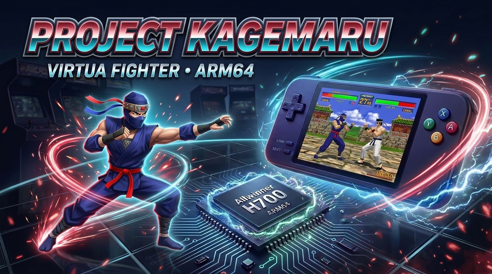

<p align="center">
  
</p>

# ProjectKagemaru — Virtua Fighter ARM64 / Anbernic RG34XX Port

[](https://github.com/DanimanX/ProjectKagemaru/actions/workflows/build-arm64.yml)

An **ARM64 (AArch64) & OpenGL ES 2.0** handheld port of [vf1-recomp](https://github.com/mr-finster/vf1-recomp) (static recompilation of **Virtua Fighter** — Sega Model 1, 1993), engineered for the **Anbernic RG34XX** (**Allwinner H700** / Mali-G31 MP2, 720×480 3:2 GBA form factor) and compatible Linux **PortMaster** handhelds.

Following our [ProjectDural](https://github.com/DanimanX/ProjectDural) architecture, **ProjectKagemaru** leverages `vf1-recomp`'s built-in **SLJIT ARM64** backend (`sljitNativeARM_64.c`) to statically recompile Virtua Fighter's NEC V60 program directly into native AArch64 machine code in memory at startup (**zero PC pre-build required**). Simply drop your own legal MAME `vf.zip` into `roms/` and play!

> **Bring Your Own Data (BYOD):** No copyrighted ROMs or ROM-derived compiled code are included in this repository or its releases. You must supply your own legally dumped MAME `vf.zip` (including `315-5724.bin`).
>
> *"Virtua Fighter"* and *"Sega Model 1"* are trademarks of their respective owners. This project is independent and not affiliated with SEGA.

---

## Hardware Feasibility & 57.52 FPS Performance on Allwinner H700 (Anbernic RG34XX)

Sega Model 1 runs Virtua Fighter at a native arcade frame rate of **57.524 FPS** (`17.38 ms` frame budget) with 30 Hz internal 3D logic, which ProjectKagemaru smoothly interpolates to full **57.524 / 60 FPS** motion (`model1_interp.cpp`).

| Subsystem | Anbernic RG34XX Hardware | Sega Model 1 Arcade Target | ProjectKagemaru Engineering |
|---|---|---|---|
| **CPU** | **Allwinner H700** — 4× ARM Cortex-A53 @ 1.5 GHz (`aarch64`) | NEC V60 @ 16 MHz + Fujitsu TGP MB86233 @ 16 MHz + Motorola 68000 @ 10 MHz + Z80 @ 4 MHz | **On-device SLJIT ARM64 static recompilation** (`src/rt/native.cpp` + `assets/vf_map.txt`) + **pre-decoded computed-goto TGP** (`src/core/mb86233.cpp`) with deterministic `-fno-fast-math -ffp-contract=off` float semantics. |
| **4-Core Pipeline** | All 4 Linux cores schedulable (`pthread_setaffinity_np`) | Main CPU + TGP + 68000/MultiPCM Sound + System 24 2D | **Core 0:** Main loop, `render_parts()` snapshot & GLES 2.0 submit · **Core 1:** `EmuWorker` (SLJIT V60 + TGP + I/O) · **Core 2:** Decoupled `SoundWorker` (68000 + dual MultiPCM, ~8.5 MB ROM clone) · **Core 3:** Adaptive-rate SDL2 audio callback + `row_pool` helper. |
| **GPU** | **ARM Mali-G31 MP2** (OpenGL ES 2.0 / 3.2, **no Vulkan**) | Model 1 flat-shaded 3D polygon rasterizer + System 24 4-layer tilemaps | Desktop `SDL_GPU` (Vulkan) does not run on H700. ProjectKagemaru implements a dedicated **OpenGL ES 2.0 / GLSL ES 1.00** renderer (`platform/arm64/gpu_gles.cpp`) with zero CPU 3D rasterization, indexed quad batching, 8-bit hardware stencil shadows (smooth & checkerboard), and ARM64 NEON dirty-row `RGB565`/`RGBA5551` 2D uploads. |
| **RAM** | **1 GB LPDDR4** (~750–850 MB free) | ~32 MB V60 address space + ~8.5 MB sound ROMs | **~95–130 MB total peak RSS** (Core 2 `SoundWorker` clones only `sndcpu` + `pcm1` + `pcm2` ~8.5 MB). |
| **Display** | 3.4" IPS **720×480** (3:2, 60 Hz) | 496×384 (4:3, 57.524 Hz) | **Native 3:2 Widescreen (`558×384` → `720×480`)** with true widened Model 1 3D frustum, plus `4:3 Original` (`620×480`) and `Stretch` toggles. |
| **Controls** | D-Pad + A/B/X/Y + L1/L2/R1/R2 (**no analog sticks**) | 8-way Stick + Guard / Punch / Kick | **Saturn / VF ergonomic layout** (`X`=Guard, `A`=Punch, `B`=Kick) with single-button **throw & combo macros** (`Y`=G+P, `R1`=P+K, `L1`=G+K, `R2`=P+K+G), plus 2P USB/BT gamepad hot-plug. |

### Projected Frame-Time Budget on Allwinner H700 (`17.38 ms` @ 57.52 FPS)

| Execution Path | Core 1 (SLJIT V60+TGP) | Core 2 (68k+MultiPCM) | Core 0 + Mali-G31 GPU | Expected FPS |
|---|---|---|---|---|
| **ProjectKagemaru GLES 2.0 + SLJIT ARM64 + Core 2 SoundWorker** | ~4.5 – 7.5 ms *(parallel)* | ~2.5 – 4.0 ms *(parallel)* | ~2.5 – 4.5 ms | **57.52 FPS locked** *(100% arcade speed + 60fps smooth 3D)* |
| **CPU Software Rasterizer (`model1` fallback)** | ~25 – 50 ms | ~2.5 – 4.0 ms | — | ~20 – 35 FPS *(diagnostic fallback only)* |

### Compatible Handhelds
Compiled for **`aarch64-linux-gnu` / `glibc <= 2.28`** (statically linking `libc++` and `zlib 1.3.1` via Zig, dynamically loading the firmware's hardware-accelerated `libSDL2-2.0.so.0` and OpenGL ES 2.0):
- **Anbernic XX (Allwinner H700):** RG34XX, RG35XX Plus / H / SP / 2024, RG40XX H / V, RG CubeXX, RG28XX (muOS, Knulli, ROCKNIX, Stock OS)
- **Rockchip RK3566 (Cortex-A55 @ 1.8 GHz):** Powkiddy RGB30 / X55, Anbernic RG353 / RG503, Miyoo Flip
- **Allwinner A133P / TrimUI:** TrimUI Smart Pro, TrimUI Brick
- **ARM64 SBCs:** Raspberry Pi 4 / 5, Orange Pi Zero 2W / 3 (64-bit Linux)

---

## Architecture: Standalone On-Device SLJIT + 4-Core Pipeline

```text
  [Distributable PortMaster ZIP — 100% ROM-free & Game-Code-Free]
    projectkagemaru/vf1.aarch64  (zero PC .so pre-build needed!)
         │
         ├──► Startup (~40 ms): SLJIT ARM64 compiles user's roms/vf.zip V60 -> native AArch64
         │
         ├──► Core 0: render_parts() snapshot + NEON 2D + GLES 2.0 Mali-G31 batch submit
         ├──► Core 1: EmuWorker (SLJIT V60 + Pre-decoded MB86233 TGP + I/O)
         ├──► Core 2: Decoupled SoundWorker (68000 @ 10 MHz + dual MultiPCM, ~8.5 MB ROMs)
         └──► Core 3: Adaptive-rate 48 kHz SDL2 audio callback + auxiliary row_pool
```

---

## Quick Start (Anbernic RG34XX / PortMaster)

### 1. Build the Distributable PortMaster Runtime (on Linux x86_64)
Requires `curl`, `git`, `python3`, `tar`, `zip`, `binutils`. Zig 0.17.0, SDL2 2.32.10 headers, zlib 1.3.1, and Dear ImGui are fetched automatically at pinned versions/commits:

```bash
tools/build-arm64.sh
```

This creates **`dist/ProjectKagemaru-PortMaster-aarch64.zip`** (zero ROMs, zero game code) containing:
- `Virtua Fighter.sh` (PortMaster launcher with `performance` CPU governor lock)
- `projectkagemaru/vf1.aarch64` (ARM64 Cortex-A53, SLJIT ARM64, OpenGL ES 2.0, NEON, max `GLIBC_2.28`, static `zlib` & `libc++`)
- `projectkagemaru/assets/vf_map.txt` (V60 function/jump address map for SLJIT)
- `projectkagemaru/cover.jpg`, `gamecontrollerdb.txt`, `port.json`, `gameinfo.xml`, and licences

### 2. Extract to Your Handheld & Copy Your Legal `vf.zip`
1. Extract `ProjectKagemaru-PortMaster-aarch64.zip` into your PortMaster `ports/` folder (e.g., `/mnt/sdcard/ports/` on muOS, `/userdata/roms/ports/` on Knulli, `/roms/ports/` on ArkOS).
2. Copy your legally dumped MAME `vf.zip` (including `315-5724.bin`) into `ports/projectkagemaru/roms/vf.zip` (and optionally `model1io.zip`).
3. Launch **Virtua Fighter** from Ports!

---

## Default Controls (Anbernic RG34XX)

All gameplay buttons can be rebound inside **Menu → Controls**:

| Action | Anbernic RG34XX Default | Notes |
|---|---|---|
| **Move / Crouch / Jump** | **D-Pad** *(or Left Stick)* | Arcade 8-way |
| **Guard (G)** | **X (West)** | Saturn-style thumb layout |
| **Punch (P)** | **A (South)** | |
| **Kick (K)** | **B (East)** | |
| **Throw Macro (G+P)** | **Y (North)** | Single-button throw |
| **P+K / G+K Macros** | **R1 / L1** | |
| **All Three (P+K+G)** | **R2** | |
| **Start / Insert Coin** | **Start / Select** | Free Play enabled by default |
| **Pause & Settings Menu** | **Start + Select** *(or Menu button)* | Saves `settings.ini` & NVRAM |
| **Cabinet Test / Service** | **Select + Y** / **Select + X** | |

---

## In-Game Features & Cheats

Open the in-game menu (**Start + Select** or **Menu**) to configure:
- **Display:** `3:2 Widescreen` (`558×384`), `4:3 Original` (`496×384`), or `Stretch Fill`; GLES 2.0 vs CPU 3D toggle; `1x` / `2x` Internal Scale; Smooth Blended vs Arcade Checkerboard Shadows; 60fps Smooth Motion toggle; Sky Filter; HUD Hide; VSync; FPS/Polygon overlay.
- **Audio:** Master / Music / SFX volumes, Mute, and **YM3438 FM Synth** toggle (OFF by default for extra Core 2 headroom since VF1 FM is silent).
- **Arcade Settings:** Free Play vs Coin mode, Difficulty, 1P Rounds to Win (`2–5`), Cabinet Language (`Japanese` / `English`), and Hold Test Button.
- **Cheats & Secrets:** Unlock **Siba (Majido)**, **Jeff**, **Takeru**, **Koskol brothers**, or **Dural** on Akira's slot; **Dural Colour** (`Chrome` / `Gold P2` / `Gold Both`); **Kage Unmasked**; **Random Fighters** (P1 / CPU Opponents / Both); **Fight Switches** (Infinite Energy, One-Hit KO, No Time Limit, Ring Width `Arcade / 1500 / 1400 / 1300 / 1200`).

---

## Upstream Attribution & Licence

- Upstream project: **[mr-finster/vf1-recomp](https://github.com/mr-finster/vf1-recomp)** — original static recompilation of Sega Model 1 Virtua Fighter (SLJIT V60, MB86233 TGP, M68000, MultiPCM, Z80 I/O, and hardware runtime).
- Licence: **[MIT](LICENSE)** for ProjectKagemaru / `vf1-recomp` code; MAME components keep their **BSD-3-Clause** licence (`third_party/mame/README.md`); SLJIT keeps **BSD-2-Clause** (`third_party/sljit/LICENSE`); Musashi & Z80 keep **MIT**; ymfm keeps **BSD-3-Clause**.
- The licence does **not** cover Virtua Fighter itself; ROM sets are never distributed.
